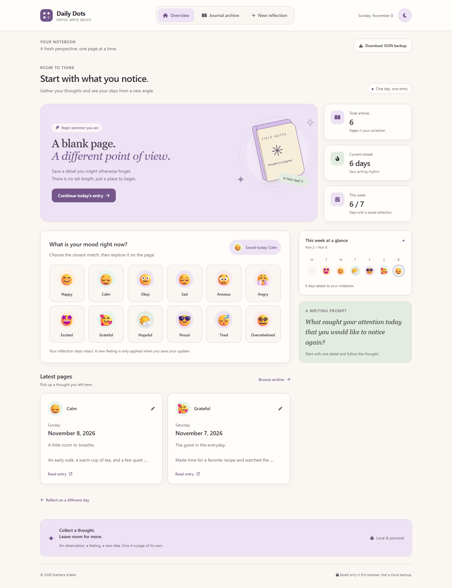
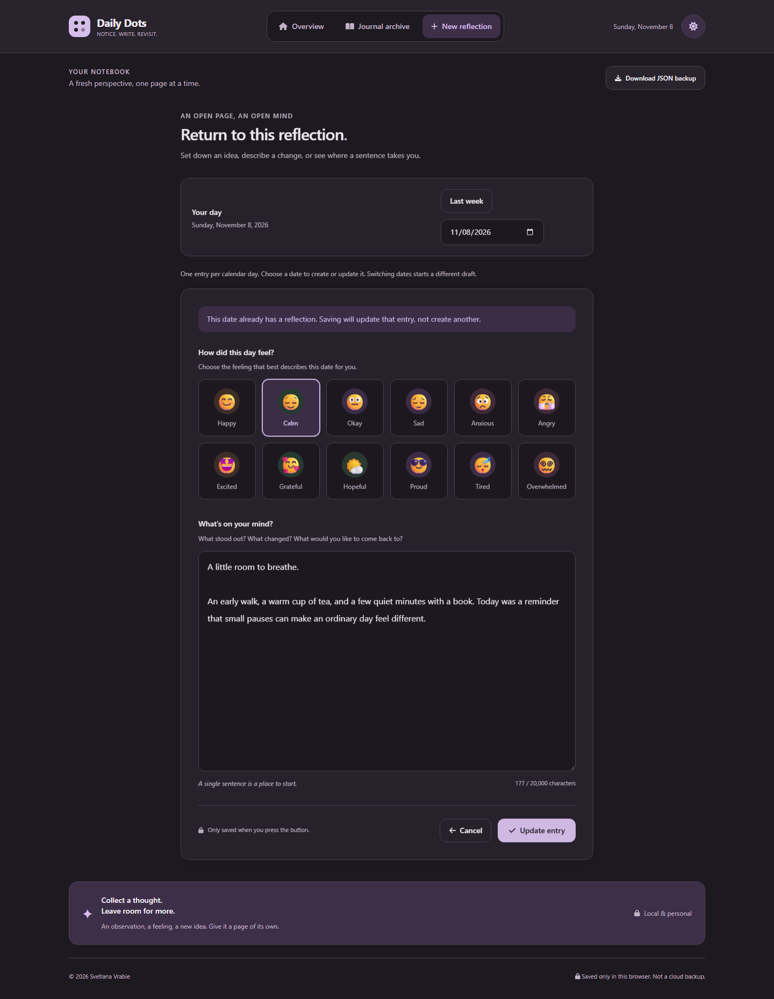

# Daily Dots

**Notice. Write. Revisit.**

A little space to reflect on your day. Daily Dots brings daily journaling
and mood tracking together in a calm, local-first notebook: choose a date,
pick how you feel, and capture a thought worth keeping.

**One day, one entry · 12 moods · Light & dark themes · No account required**

Built with **React, TypeScript, Vite, and Tailwind CSS**. Entries stay in
your browser; no backend or cloud account is needed.

[Screenshots](#screenshots) · [Features](#features) ·
[Run locally](#run-locally) · [Data & privacy](#data-and-privacy) ·
[Development](#development)

## Screenshots

### Your day at a glance

Check in with your mood, follow your writing streak, and revisit recent
reflections from one overview.



### A quieter writing space in dark mode

Choose a date and a mood, then write at your own pace. Returning to a
saved date opens that reflection for editing.



*Both screenshots use fictional demonstration entries, not personal journal data.*

## Features

| | What you can do |
| --- | --- |
| **Daily reflections** | Write one plain-text entry per calendar date. Reopen any date to continue or edit it. |
| **Mood check-in** | Choose from 12 labeled emotions, from calm and grateful to tired and overwhelmed. |
| **Weekly overview** | See your mood dots, total entries, current writing streak, and this week's progress. |
| **Journal archive** | Browse newest-first entries, search by text/date, filter by mood, and open full reflections. |
| **Light & dark** | Switch between soft lavender, sage, and cream or warm charcoal with pastel accents. Your choice is remembered. |
| **Local backups** | Download a versioned JSON copy of your entries. Deletion always asks for confirmation. |

The responsive, sidebar-free layout uses horizontal navigation on larger
screens and bottom navigation on phones. Theme and backup controls remain
available at every size. Labeled moods, keyboard-friendly controls,
confirmation dialogs, and reduced-motion support keep everyday
interactions clear.

### A simple daily ritual

1. **Notice** how you feel using the overview's quick mood check-in.
2. **Write** a reflection for today, or choose another date, then save it.
3. **Revisit** your weekly moods and past pages whenever you want a fresh perspective.

Choosing a mood opens today's reflection with that feeling selected; it
does not save automatically or discard existing text.

## Run locally

Requires **Node.js 22.12+** (Node 22 or 24 LTS recommended) and **npm**.

```sh
npm install
npm run dev
```

Open the local URL printed by Vite. No environment variables, Supabase
account, authentication, or backend are required.

> **Windows PowerShell:** if script execution blocks `npm`, use
> `npm.cmd install` and `npm.cmd run dev` instead. No execution-policy
> changes are needed.

## Data and privacy

Entries live **only in this browser on this device**, under `daily-dots:journals:v1` in localStorage. They are not encrypted, synced, associated with an account, or protected against scripts or other people with access to the browser. Clearing site data, changing browsers, or changing the development server's origin can make entries unavailable. No journal content is sent to external services.

Use **Download JSON backup** regularly, and keep the downloaded file private. This release offers backup export only, not automatic restore/import. Backups contain a format marker, version, export timestamp, and all journal entries; the theme is a separate device preference. Do not clear browser data before saving a backup.

To delete an entry, open its details and select the trash button. The confirmation dialog lets you keep the entry or permanently delete it. Confirmed deletions are saved locally and excluded from subsequent JSON downloads. Previously downloaded backup files are not changed.

Malformed or unsupported stored data blocks journal operations rather than silently deleting or replacing it. For recovery, copy the raw `daily-dots:journals:v1` value from your browser's developer tools (Application/Storage → Local Storage) into a private file before attempting any repairs. Storage quota/access failures are surfaced, and an unsuccessful save leaves the draft visible.

<details>
<summary><strong>How dates, drafts, and writing streaks work</strong></summary>

The entry's local `YYYY-MM-DD` date is its unique key, independent of timezone offsets and daylight-saving changes. Saves update that date in place, preserve its creation timestamp, and refresh the update timestamp. Weeks run Monday–Sunday. The current streak includes consecutive entries ending today, or yesterday when today has not yet been written; future entries do not extend it.

Drafts are saved only with the save button. Date switching and cancellation warn before discarding, and closing/reloading the tab warns about unsaved edits. Navigating away through other application links does not save a draft.

On New reflection, **Last week** expands or collapses seven date buttons
for the calendar week before the current week (Monday–Sunday), not a
rolling seven-day window or a week relative to the selected date.
Opening the choices does not change or save the draft. Selecting another
date asks for confirmation, then loads that day's saved reflection or a
blank draft. Cancelling preserves the draft; selecting the current date
does nothing. Date controls show pointer cursors, support keyboard use,
and wrap on phones. The native date input remains available for any date.

</details>

## Development

### Commands

```sh
npm test          # Vitest + React Testing Library
npm run lint     # ESLint
npm run typecheck
npm run build    # TypeScript checks + production bundle
npm run preview  # Serve the production bundle locally
```

Use a maintained Node version to run the patched Vite and Vitest tooling.
TypeScript 5.9 supports the declaration syntax used by the Vite React
plugin. The ESLint parser/plugin are kept compatible with this compiler;
a scoped npm override keeps their transitive `minimatch` dependency on
the patched 11.x line.

### Project structure

```text
src/
  app/                      Application, routing, provider, layout
  features/dashboard/       Home summary
  features/journal/         Domain validation, forms, pages, hooks, summaries
  infrastructure/storage/   localStorage journal repository and preferences
  shared/                   Shared UI, dates, privacy-safe diagnostics
  styles/                   Tailwind directives and theme tokens
  test/                     Test setup
```

The UI consumes the asynchronous `JournalRepository` contract through `JournalProvider`. The local implementation owns runtime validation, versioned storage, and date-keyed upserts. A future Supabase repository can implement the same contract and be injected in `App` without putting database calls into components. Supabase persistence and authentication are deliberately not implemented.

### Deployment

`npm run build` creates `dist`. Deploy its contents to a static host configured to serve `index.html` for unknown paths, so React Router deep links work. The development/preview servers bind to localhost by default.

Setup follows [React's Vite guidance](https://react.dev/learn/build-a-react-app-from-scratch#vite), with routing and styling added explicitly.

### Contributor and agent guidance

- [AGENTS.md](AGENTS.md): workflow, architecture boundaries, privacy, and validation.
- [Copilot instructions](.github/copilot-instructions.md): current product scope and project conventions.
- [General engineering](.github/instructions/general.instructions.md): focused changes and documentation consistency.
- [Design](.github/instructions/design.instructions.md): pastel tokens, layout, navigation, accessibility, and responsive validation matrix.
- [CSS and Tailwind](.github/instructions/css-tailwind.instructions.md): styling implementation and mobile safe areas.
- [TypeScript and React](.github/instructions/typescript-react.instructions.md): types, components, state, repositories, and regression coverage.

For UI changes, run the tests, lint, type checks, and build above, then
validate the affected pages at phone, tablet, and desktop sizes in both
themes. Use only synthetic entries on an isolated origin; never replace
real journal data during testing. Documentation-only changes need link,
instruction-frontmatter, and consistency checks rather than an application
rebuild.

## Copyright

© 2026 Svetlana Vrabie
